# Olá, sou Kleiber Ferreira

Este é meu portfólio de aplicações. Aqui compartilho os projetos que desenvolvo para resolver problemas do dia a dia.

## Projetos

[Sistema de Ponto](#sistema-de-ponto) · [Sistema de Estoque](#sistema-de-estoque) · [Gerenciador de Discos](#gerenciador-de-discos)

### Sistema de Ponto

Desenvolvi uma aplicação web para registrar jornadas de trabalho e ajudar o RH a acompanhar a frequência e fechar as folhas de ponto.

- **Registro de jornada** — marcação de entradas e saídas e consulta ao histórico.
- **Rotina do RH** — gestão de funcionários, análise de justificativas e acompanhamento do banco de horas.
- **Fechamento de períodos** — conferência das marcações e geração de folhas de ponto em PDF.

Atuei na arquitetura e no desenvolvimento da aplicação, da interface à persistência dos registros e à geração dos relatórios.

**Tecnologias** — Python, SQLite, JavaScript, HTML e CSS.

#### Demonstração com dados fictícios

**Meu ponto** — O funcionário registra a jornada e acompanha seu histórico e as pendências.

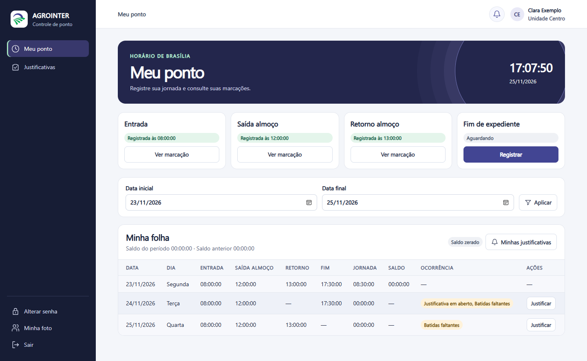

**Validação de justificativas** — O RH analisa solicitações de atraso ou marcação faltante e decide se deve validar, devolver ou recusar.

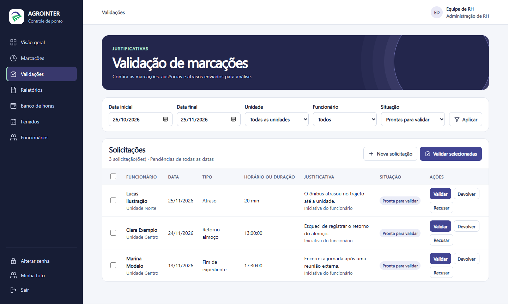

**Fechamento do período** — O RH confere horas previstas, trabalhadas e saldos antes de finalizar as folhas e exportá-las em PDF.

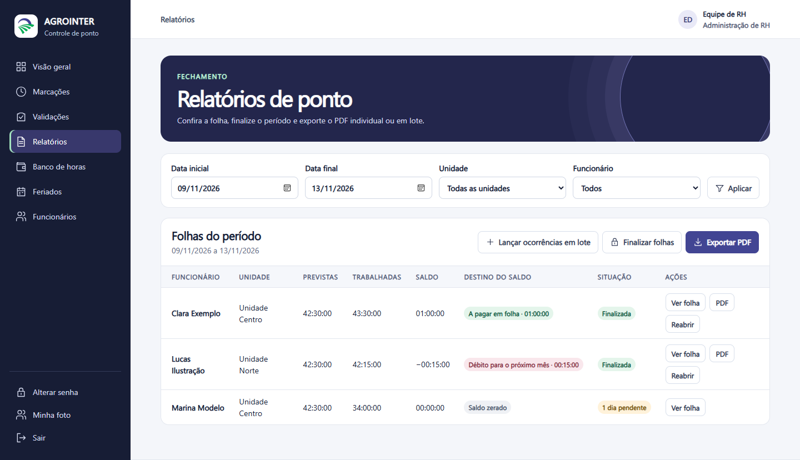

**Banco de horas** — O RH acompanha os saldos por funcionário, os créditos e débitos lançados e o valor a pagar em folha.

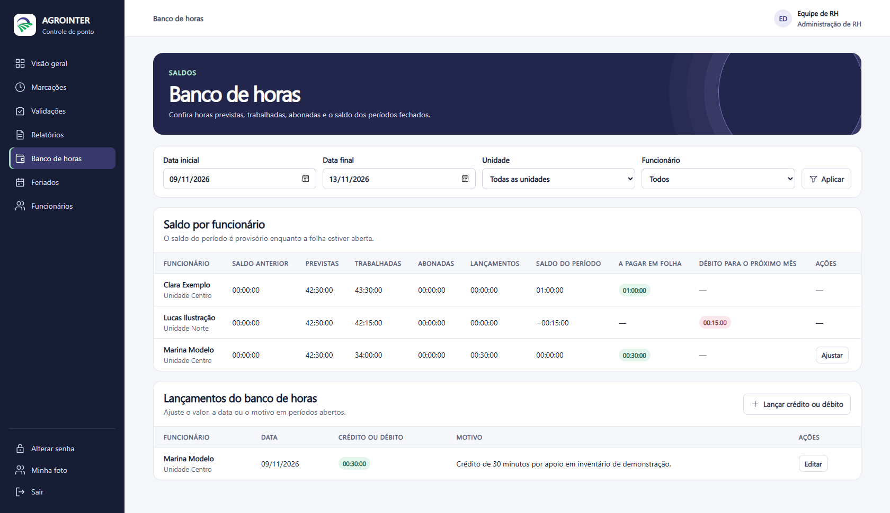

**Folha finalizada** — A folha individual reúne as marcações diárias, as horas previstas e trabalhadas e o saldo do período após o fechamento.

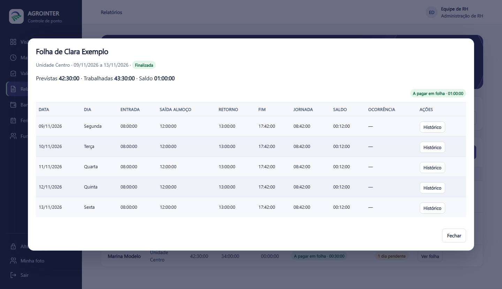

**Relatório gerado em PDF** — A folha exportada reúne as marcações, o resumo de horas e os campos de assinatura.

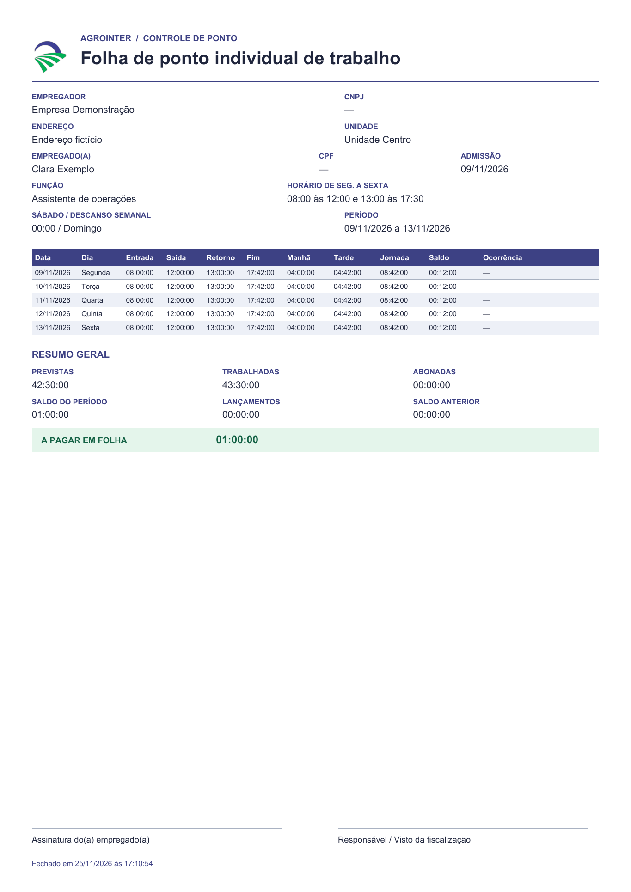

### Sistema de Estoque

Desenvolvi uma central web para organizar o inventário por filial, da identificação dos produtos à conferência dos saldos.

- **Contagem Diária** — importação de listas em CSV, contagem cega com leitura de QR e aprovação dos resultados. Quando há divergências, o responsável pode solicitar a recontagem apenas dos itens afetados.
- **Balanço de Estoque** — contagem por rua e prateleira, consolidação das rodadas e exportação em CSV para o ERP Solution.
- **Etiquetas QR** — geração de folhas A4 a partir de CSV, com código, identificação e alocação do produto.

Atuei na arquitetura e no desenvolvimento da interface, da API e dos fluxos de contagem e aprovação.

**Tecnologias** — Node.js, SQLite, JavaScript, HTML e CSS.

#### Demonstração do estoque com dados fictícios

**Central de operações** — acesso aos três módulos do sistema.

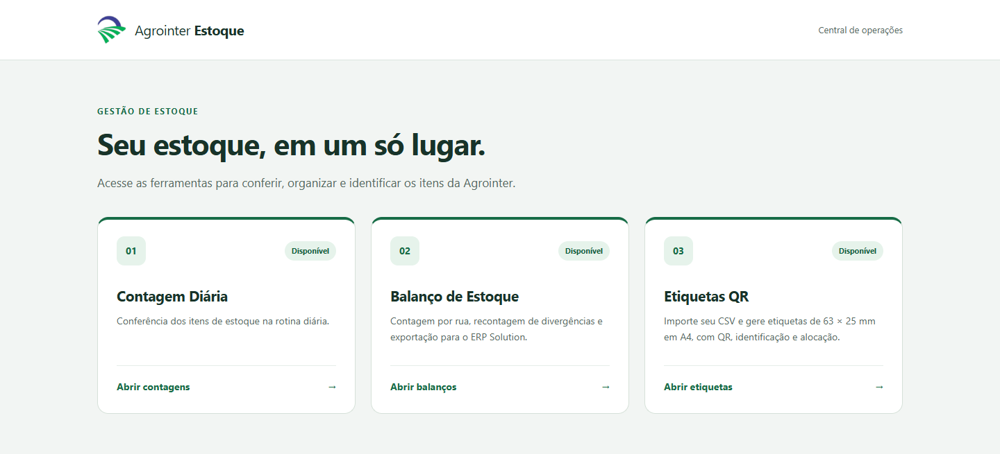

**Contagem Diária** — o estoquista registra as quantidades após identificar os produtos pelo QR. O saldo de referência fica oculto durante a coleta.

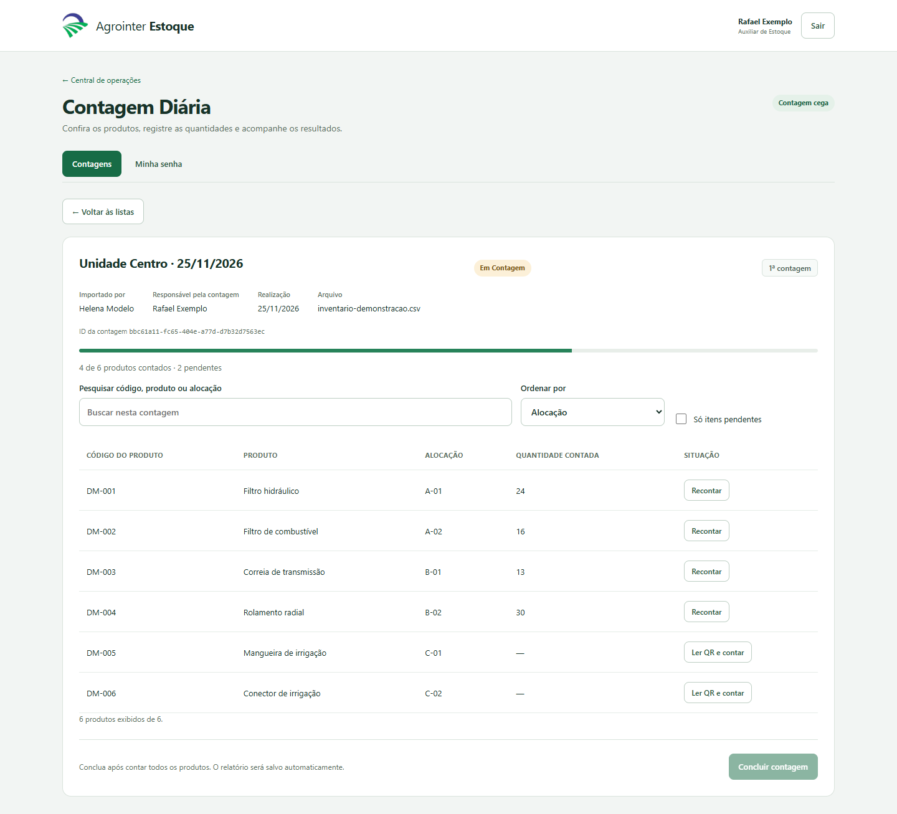

**Balanço de Estoque** — o painel mostra a proporção de itens conformes e divergentes, com filtros por balanço, linha de produto, funcionário, rua e alocação.

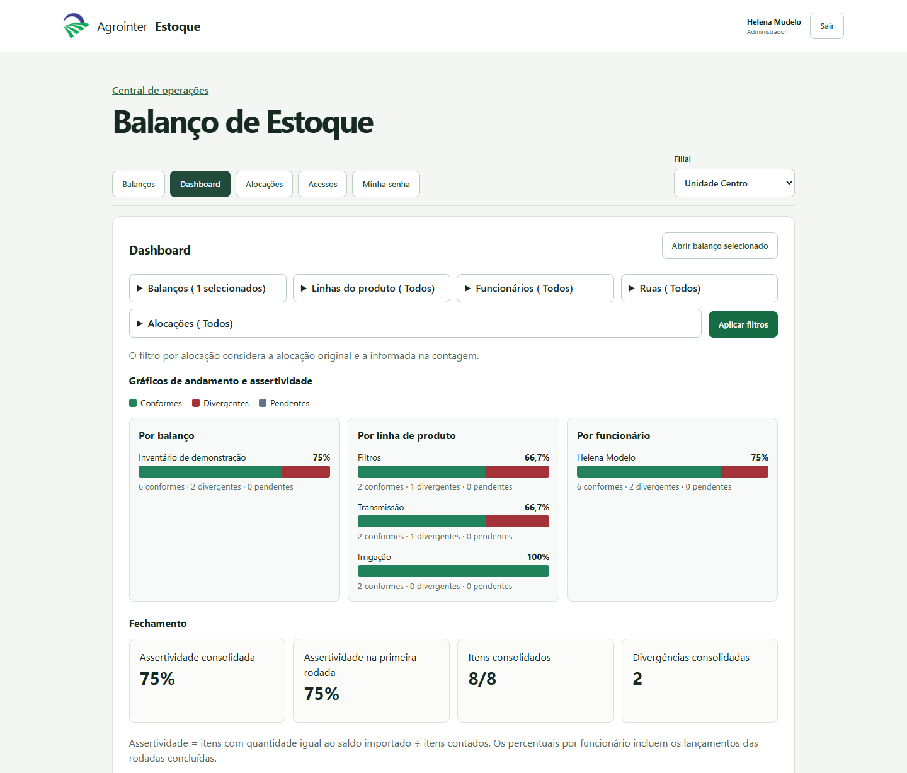

**Etiquetas QR** — prévia da folha A4 com os códigos, as descrições e as posições dos itens.

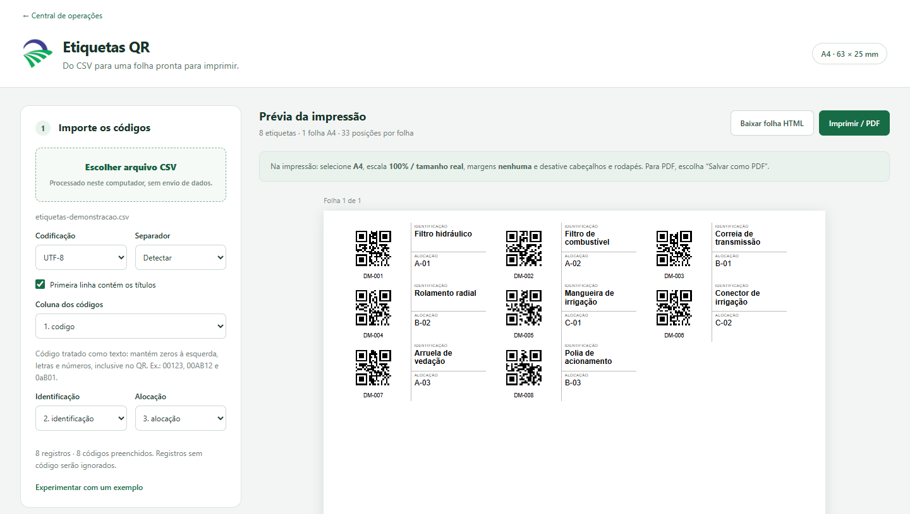

**Relatório de contagem** — o relatório gerado após a aprovação compara as quantidades contadas com os saldos do sistema e destaca as diferenças.

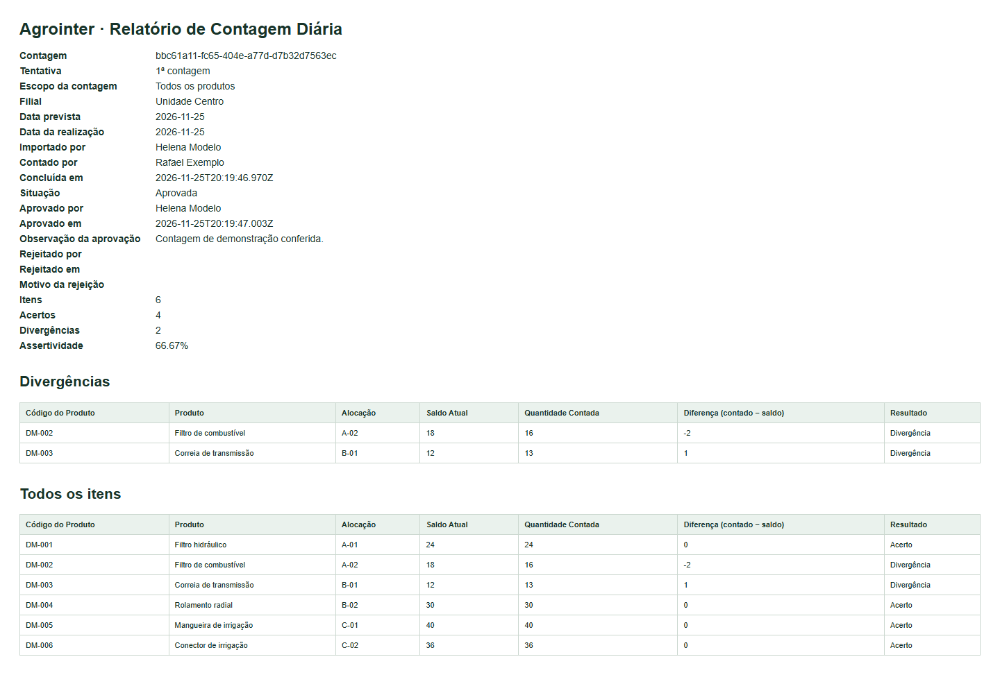

### Gerenciador de Discos

Desenvolvi uma ferramenta de terminal para formatar pendrives e gerenciar discos e partições no Windows. A ferramenta reúne operações de armazenamento em um menu e mostra o dispositivo e o efeito da ação antes de pedir confirmação.

- **Consulta** — lista discos e partições e ajuda a distinguir unidades USB do disco do sistema.
- **Formatação e particionamento** — oferece NTFS, exFAT e FAT32 conforme o tamanho do volume e permite criar, redimensionar ou excluir partições.
- **Controle de operações** — protege discos do sistema, exige confirmação específica e revalida a identidade e o layout do disco antes de alterar o dispositivo.

A suíte inclui 33 verificações com discos simulados, incluindo cancelamento, troca de dispositivo e registro de falhas.

**Tecnologias** — Windows PowerShell 5.1 e módulo Storage do Windows.
